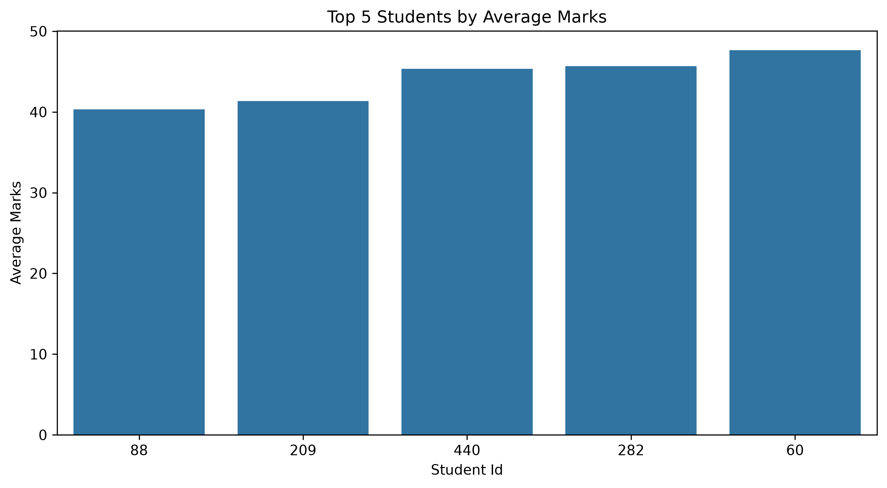

# Student Performance Analysis

## Project Overview
This project analyses student academic performance in Mathematics, Science, and English using Python, statistical analysis, and data visualization.

## Objectives
- Analyse students' marks across three subjects.
- Calculate total and average marks.
- Examine grade distribution.
- Identify variations in student scores.
- Explore relationships between subject scores.
- Present findings through visualizations.

## Technologies Used
- Python
- Pandas
- NumPy
- Matplotlib
- Seaborn
- Jupyter Notebook

## Project Workflow
1. Data Understanding
2. Data Cleaning
3. Exploratory Data Analysis (EDA)
4. Statistical Analysis
5. Data Visualization
6. Insights and Conclusion

## Visualizations
- Subject-wise performance bar chart
- Score distribution box plot
- Correlation heatmap
- Grade distribution chart

## Key Findings
Add your actual findings here after analysing the results, including subject averages, grade distribution, and important relationships between scores.

## Conclusion
This project demonstrates how Python-based data analysis can help summarize student performance, identify academic strengths, and highlight areas that may require additional support.

## How to Run
1. Clone or download this repository.
2. Install the required libraries:
   `pip install pandas numpy matplotlib seaborn jupyter`
3. Open the notebook in Jupyter Notebook or VS Code.
4. Run the cells in order.
## Project Preview

## Key Findings

- **Subject Performance:** English had the highest average score at **72.16**, followed by Science at **70.30** and Mathematics at **68.44**.
- **Top Performer:** Student **STU0276** achieved the highest average marks of **100.00**.
- **Other High Performers:** The next four students in the top five achieved average marks ranging from **92.33 to 94.33**.
- **Grade Distribution:** Grade **B** was the most frequent grade, awarded to 178 students, followed by Grade C (155 students).
- **Improvement Opportunity:** Mathematics had the lowest average score among the three subjects, suggesting that it may be worth examining where students need additional support.

